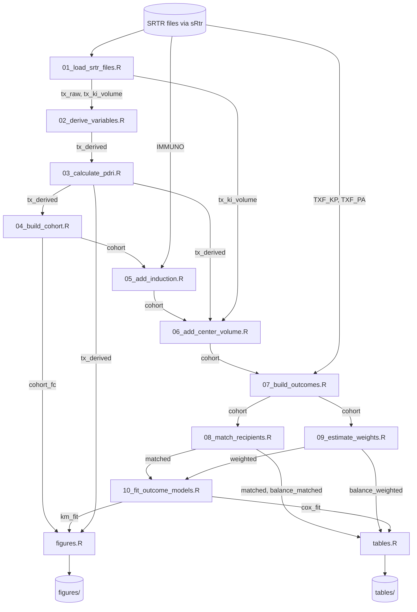

# Architecture

Revision scope: `main` at `d8f8831` plus branch `code/draft-pipeline` (pull request #23). Update this file in the same pull request as any change to the scripts, their order, or the objects they pass.

## Overview

The analysis is a sequence of R scripts that share one R session: each script reads objects that earlier scripts created and adds its own. Two entry points exist while the code is a draft:

- `R/main.R` runs the **definitive** analysis. Today it sources only `R/setup.R` and `R/functions.R`.
- `R/draft_pipeline.R` runs the **exploratory** draft of the whole analysis: `setup.R`, `functions.R`, the numbered scripts `01` to `10`, then `tables.R` and `figures.R`.

A script moves from the draft runner into `main.R`, with its website page and an update here, once its open decisions are settled and it has run in the approved environment (`AGENTS.md`, "Exploration and definitive analysis"). The scientific specification is `analysis-plan.md`; this file describes only how the code is organized.

SRTR data never enter the repository. Every SRTR file is read through the sRtr package (`sRtr::load_srtr_file()`), which finds the files in the folder set by `sRtr::set_srtr_wd()`. Public data (OPTN regions) also come from sRtr.

## Architecture diagram

`setup.R` (packages and constants) and `functions.R` (helpers) are sourced first and used by every script; they are left out of the diagram.

## Components

### Setup and helpers (definitive)

**Location:** `R/setup.R`, `R/functions.R`

`setup.R` attaches every package and defines every constant: transplant types, cohort limits, code lists, matching and weighting settings, the outcome list (`OUTCOMES`), and output folders. Each constant that depends on an open decision carries a `Decision pending: #N` comment and a provisional value.

`functions.R` holds helpers that take their inputs as arguments: `srtr_code()` (numeric code from a labelled SRTR value), `diagnosis_group()`, `impute_preservation_time()`, `center_volume()` and `center_volume_group()`, `induction_flags()`, `att_weights()`, `weighted_smd()` and `balance_table()`, `lorenz_points()` and `gini_coefficient()`, and `add_followup_dates()` (a guard around `sRtr::add_txf_outcomes()`). Several stand in for planned sRtr functions and name the sRtr issue that will replace them.

### Data preparation (exploratory)

| Script | Reads | Creates or changes |
|---|---|---|
| `R/01_load_srtr_files.R` | `TX_KP`, `TX_PA`, `TX_KI` via sRtr | `tx_raw` (named list `KP`, `PA`); `tx_ki_volume` (three `TX_KI` columns) |
| `R/02_derive_variables.R` | `tx_raw` | `tx_derived`: HIV status, diagnosis group, Black race, transplant year, waiting time; pancreas-alone date columns copied to the kidney–pancreas names |
| `R/03_calculate_pdri.R` | `tx_derived` | `tx_derived` with filled preservation time and `PDRI` (via `sRtr:::add_pdri()`) |
| `R/04_build_cohort.R` | `tx_derived` | `cohort` (named list of analytic cohorts) and `cohort_fc` (flowchart objects split by HIV status, for the diagram) |
| `R/05_add_induction.R` | `cohort`, `IMMUNO` via sRtr | `cohort` with `INDUCTION_*` columns |
| `R/06_add_center_volume.R` | `cohort`, `tx_derived`, `tx_ki_volume` | `cohort` with center volume counts and groups |
| `R/07_build_outcomes.R` | `cohort`, `TXF_*` via sRtr | `cohort` with `<OUTCOME>_CENSOR`, `<OUTCOME>_BINARY` and `<OUTCOME>_yrs` for each outcome |

The cohort is built only with flowchart (`flowchart::as_fc()`, `flowchart::fc_filter()`), so the flow diagram and the analytic data come from the same code. Every later script keeps one row per transplant; joins assert that the row count did not change.

### Comparison and models (exploratory)

| Script | Reads | Creates |
|---|---|---|
| `R/08_match_recipients.R` | `cohort` | `match_fit` (MatchIt objects), `matched` (matched data with `weights` and `subclass`), `balance_matched` |
| `R/09_estimate_weights.R` | `cohort` | `ipw_fit` (propensity models), `weighted` (cohort with `PS` and `IPW`), `balance_weighted` |
| `R/10_fit_outcome_models.R` | `matched`, `weighted` | `km_fit`, `cox_fit`: nested lists indexed `[[analysis]][[type]][[outcome]]`, where analysis is `matched` or `weighted` |

Matching stops with an error if any matching variable is missing, rather than dropping recipients, because that handling is an open decision.

### Outputs (exploratory)

**Location:** `R/tables.R`, `R/figures.R`

`tables.R` builds Table 1 before and after matching (gtsummary), a combined balance table, and stacked Cox model tables, saved as HTML in `tables/`. `figures.R` draws the cohort flow diagrams, Kaplan–Meier curves with risk tables (ggsurvfit), the map of recipients with HIV by UNOS region, Lorenz curves of concentration across centers, and transplants and centers per year, saved as images in `figures/`. Both folders are gitignored until outputs are cleared under the SRTR small-cell rule.

### Tests

**Location:** `tests/testthat/`

`helper-setup.R` evaluates only the constants section of `setup.R` (so tests run without sRtr installed) and builds synthetic cohorts. `test-functions.R` checks each helper against hand-calculated answers. `test-pipeline-synthetic.R` runs `08_match_recipients.R`, `09_estimate_weights.R` and `10_fit_outcome_models.R` end to end on synthetic data. Scripts `01` to `07`, `tables.R` and `figures.R` are not yet covered, because they need sRtr, flowchart, gtsummary or ggsurvfit.

### Website

**Location:** `_quarto.yml`, `index.qmd`, `quarto/`

The Quarto site documents the code without running it. `quarto/setup.qmd` and `quarto/functions.qmd` import their scripts' labelled sections with `knitr::read_chunk()`; the project-document pages include the root files. `.github/workflows/publish.yml` renders the site on every pull request and publishes it to the `gh-pages` branch on every push to `main`.

## Configuration

- **Data location:** `SRTR_WD`, set with `sRtr::set_srtr_wd()`; the release is whatever that folder holds (label in `SRTR_RELEASE`).
- **Analysis settings:** all in `R/setup.R`. Changing an open decision means changing one constant there.
- **Outputs:** `TABLES_DIR` and `FIGURES_DIR` in `R/setup.R`.

## Code references

| Component | File | Key symbols |
|---|---|---|
| Entry points | `R/main.R`, `R/draft_pipeline.R` | — |
| Constants | `R/setup.R` | `TRANSPLANT_TYPES`, `MATCHING_VARIABLES`, `IPW_COVARIATES`, `OUTCOMES` |
| Helpers | `R/functions.R` | `srtr_code()`, `att_weights()`, `balance_table()`, `add_followup_dates()` |
| Cohort | `R/04_build_cohort.R` | `cohort`, `cohort_fc`, `cohort_labels` |
| Outcomes | `R/07_build_outcomes.R` | `outcome_dates` |
| Matching | `R/08_match_recipients.R` | `match_formula`, `matched` |
| Weighting | `R/09_estimate_weights.R` | `ipw_formula`, `weighted` |
| Models | `R/10_fit_outcome_models.R` | `surv_formula()`, `km_fit`, `cox_fit` |

## Glossary

| Term | Definition |
|---|---|
| KP, PA | Kidney–pancreas and pancreas-alone transplants; the names of each per-type list element |
| Definitive | Sourced from `R/main.R`; has a website page and is described here in full |
| Exploratory | Run only by `R/draft_pipeline.R`; may change without a website page |
| Provisional value | A constant set for an open decision until the decider settles it |
